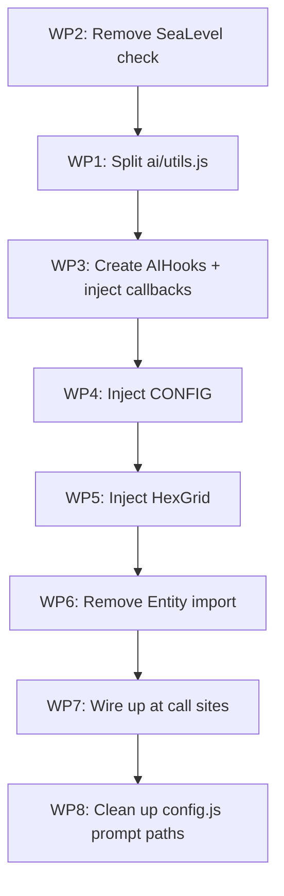

# AI Module Isolation — Work Package Plan

## Goal
Make `src/ai/` a **self-contained module** with zero hard imports to/from the rest of the engine. All engine dependencies are injected at construction time or via callback hooks.

---

## Current External Dependencies (AI → Engine)

| Module | Symbols | Used By |
|--------|---------|---------|
| `hexGrid.js` | `HexGrid`, `DIRECTIONS_8` | `utils.js`, `barbarians/manager.js`, `smartManager.js`, `llm/llmBase.js`, `llm/menu.js`, `llm/menu/menu.js` |
| `utils.js` | `camelToTitle`, `sleep`, `calculateAttackMultiplier` | `utils.js`, `smartManager.js` |
| `terrainProvider.js` | `SeaLevel` | `utils.js` (line 368) |
| `resources.js` | `applyResourceYieldBonus` | `utils.js` (line 288) |
| `renderer.js` | `reconcileEntities` | `utils.js`, `barbarians/manager.js` |
| `main.js` | `updatePlayersUI` | `utils.js` (line 615) |
| `config.js` | `CONFIG` | `utils.js`, `llm/llmBase.js`, `llm/json/harness.js`, `llm/menu/harness.js` |
| `entity.js` | `Entity` (class) | `barbarians/manager.js` (line 118 — `new Entity(meta, null, gameState, null)`) |

## Current External Dependencies (Engine → AI)

| Engine File | What It Imports |
|-------------|-----------------|
| `gameState.js` | `manageBarbarians` from `ai/barbarians/manager.js` |
| `player.js` | Dynamic `import(controller.url)` → AI manager classes |
| `main.js` | `player.getAiManager()` → calls `chat()`, `summarizeChatAndAddNote()`, `generateChatReply()` |
| `config.js` | String paths to `src/ai/llm/` prompt `.md` files |

---

## Work Packages

### WP1: Move `src/ai/utils.js` → `src/utils.js` merger + create AI-local action utils
**Problem:** `src/ai/utils.js` is the primary bridge — it imports 8 engine modules. It contains two types of code:
- **Pure AI logic** (combat selection, pathfinding, capability checks) — should stay in AI
- **Engine bridge functions** (`onActionDone`, `reconcileEntities` calls, `sleep`) — should be injected

**Steps:**
1. **Split `src/ai/utils.js` into two files:**
   - `src/ai/aiUtils.js` — All pure AI logic (pathfinding, capability checks, combat power calculations, entity sorting, etc.). **No engine imports.**
   - `src/ai/actions.js` — Action functions (`attack`, `build`, `support`, `explore`, `onActionDone`) that need engine callbacks. These accept an injected `hooks` object instead of importing directly.

2. **Update all internal AI imports** to point to the new split files.

> [!IMPORTANT]
> The user explicitly asked to move `src/ai/utils.js` out of AI. Since most of its content is AI-specific (combat selection, pathfinding, build candidate finding), I recommend **keeping the AI-specific logic inside `src/ai/`** and only removing the engine coupling. Moving 1,200 lines of AI-specific pathfinding/combat code into `src/utils.js` would pollute the general utils. Please confirm if you agree with this interpretation.

---

### WP2: Remove `SeaLevel` check in `src/ai/utils.js`
**Problem:** Line 368 checks `cell.terrain.elevation <= SeaLevel` as a filter in `findBuildCandidates`. This is redundant because:
- Line 400 already calls `sourceEntity.canStandOn(cell)` which handles traversability
- Per Mistake #2 in `mistakes.md`, magic-number elevation checks should not be used — `canStandOn()` is the authoritative check

**Steps:**
1. Remove the `SeaLevel` import from `src/ai/utils.js`
2. Remove the `cell.terrain.elevation <= SeaLevel` check on line 368
3. Verify `canStandOn()` (line 400) already covers water/sea filtering

> [!NOTE]
> The `canStandOn()` check on line 400 is only applied when `sourceEntity.canStandOn` is a function. We should verify this is always the case for entities that call `findBuildCandidates`, or add a guard.

---

### WP3: Create `AIHooks` — inject callback hooks for engine-coupled functions
**Problem:** `onActionDone()` calls `reconcileEntities()` (renderer), `updatePlayersUI()` (main), and `sleep()` (utils). These are pure engine/UI side effects.

**Design:** Create an `AIHooks` class/object that bundles all engine callbacks:

```js
// src/ai/types.js (or just a JSDoc typedef)
/**
 * @typedef {Object} AIHooks
 * @property {function(gameState, involvedCells?): void} reconcileEntities
 * @property {function(): void} updatePlayersUI  
 * @property {function(ms): Promise<void>} sleep
 * @property {function(gameState, cell, elevAdj, target): Object} calculateAttackMultiplier
 * @property {function(entity, yields, gameState): Object} applyResourceYieldBonus
 * @property {function(name): string} camelToTitle
 * @property {function(meta, owner, gameState, cell): Entity} createEntity
 */
```

**Steps:**
1. Define `AIHooks` shape (JSDoc or plain object contract)
2. Pass `hooks` into `BaseManager` constructor: `constructor(player, gameState, controller, deps)`
3. Store as `this.deps` (or `this.hooks`)
4. Refactor `onActionDone()` to use `this.deps.reconcileEntities` etc.
5. Refactor `attack()`, `build()`, `support()`, `explore()` to receive hooks
6. In `barbarians/manager.js`, accept hooks for `reconcileEntities` and `createEntity` (replaces direct `new Entity(...)`)
7. Wire up hooks at the call sites in `player.js` and `gameState.js`

---

### WP4: Inject `CONFIG` values into `BaseManager`
**Problem:** 4 AI files import `CONFIG` directly. They use these specific keys:
- `CONFIG.AI_BUILD_MAX_DISTANCE` (default params in `findBuildCandidates`, `build`)
- `CONFIG.AI_BUILD_DISTANCE_PENALTY` (default param in `build`)
- `CONFIG.AI_ACTION_SLEEP` (sleep duration in `onActionDone`)
- `CONFIG.SHOW_ALL` (visibility check in `onActionDone`)
- `CONFIG.COMMAND_PROMPT_URL`, `CONFIG.MENU_PROMPT_URL`, `CONFIG.CHAT_PROMPT_URL`, `CONFIG.CHAT_SUMMATION_PROMPT_URL` (LLM prompt paths)

**Steps:**
1. Add an `aiConfig` parameter to `BaseManager` constructor (or include it in the `deps` object from WP3)
2. Pass relevant CONFIG values as a plain object:
   ```js
   {
     buildMaxDistance: CONFIG.AI_BUILD_MAX_DISTANCE,
     buildDistancePenalty: CONFIG.AI_BUILD_DISTANCE_PENALTY,
     actionSleepMs: CONFIG.AI_ACTION_SLEEP,
     showAll: CONFIG.SHOW_ALL,
     promptUrls: { command: '...', menu: '...', chat: '...', chatSummation: '...' }
   }
   ```
3. Remove all `import { CONFIG }` from AI files
4. Update function signatures to use the injected config

---

### WP5: Inject `HexGrid` class into AI
**Problem:** `HexGrid` is imported in 6 AI files. It's used both as:
- **Static methods**: `HexGrid.distance()`, `HexGrid.axialToPixel()`
- **Instance access**: `gameState.hexGrid.getNeighbors()`, `gameState.hexGrid.getCell()`, etc.
- **Constant**: `DIRECTIONS_8`

**Steps:**
1. Add `HexGrid` class and `DIRECTIONS_8` to the `deps` object passed to `BaseManager`:
   ```js
   deps.HexGrid = HexGrid;
   deps.DIRECTIONS_8 = DIRECTIONS_8;
   ```
2. For `aiUtils.js` functions (not class methods), pass `HexGrid` as a parameter or have them accept it from a module-level registration:
   ```js
   // Option A: Parameter injection (purest)
   export function findReachableCells(gameState, unit, maxDistance, HexGrid) { ... }
   
   // Option B: Module-level init (less churn)
   let _HexGrid, _DIRECTIONS_8;
   export function initAI(deps) { _HexGrid = deps.HexGrid; _DIRECTIONS_8 = deps.DIRECTIONS_8; }
   ```
3. Remove all `import { HexGrid, DIRECTIONS_8 }` from AI files

> [!TIP]
> **Recommended: Option B (module-level init)** — Option A would require threading `HexGrid` through every function call chain, which is very invasive. A one-time `initAI(deps)` call at startup is cleaner and matches how dependency injection works in modules without a class hierarchy.

---

### WP6: Remove `Entity` import from `barbarians/manager.js`
**Problem:** `barbarians/manager.js` line 118 does `new Entity(meta, null, gameState, null)` to create a dummy entity for `canStandOn()` checks during spawn site filtering.

**Steps:**
1. Add `createEntity(meta, owner, gameState, cell)` to the `AIHooks` object
2. Replace `new Entity(...)` with `hooks.createEntity(meta, null, gameState, null)`
3. Remove `import Entity from '../../entity.js'`

---

### WP7: Wire up injection at engine call sites
**Problem:** `player.js` and `gameState.js` need to supply the deps/hooks when creating AI managers.

**Steps:**
1. In `player.js` `getAiManager()`:
   - Build the `deps` object with all hooks, config, and HexGrid
   - Pass to `new ManagerClass(this, this.gameState, this.controller, deps)`
2. In `gameState.js` `manageBarbarians()`:
   - Pass hooks to `manageBarbarians(gameState, settings, deps)`
3. Move prompt URL strings from `config.js` into the `deps.config.promptUrls` object so `config.js` no longer references AI file paths

---

### WP8: Clean up engine → AI references
**Problem:** `config.js` hardcodes paths to AI prompt files.

**Steps:**
1. Move prompt URL defaults into AI code (e.g., in `llmBase.js` or a constants file inside `src/ai/`)
2. Allow overriding via the injected config if needed
3. Remove the `*_PROMPT_URL` entries from `src/config.js`

---

## Execution Order



> [!WARNING]
> Each WP should leave the code in a working state. The split in WP1 can temporarily keep the old imports until WP3-WP6 replace them with injected deps, then WP7 wires everything up and WP8 removes the last cross-references.

---

## Final State

After all WPs:
- **`src/ai/` has ZERO imports from outside `src/ai/`**
- **No engine file imports from `src/ai/`** except:
  - `player.js`: dynamic `import(controller.url)` (unavoidable — this is the entry point)
  - `gameState.js`: `import { manageBarbarians }` (unavoidable — this is the entry point)
- All engine dependencies flow through the `deps` object passed at construction
- `src/ai/utils.js` is gone — replaced by `src/ai/aiUtils.js` (pure logic) + `src/ai/actions.js` (hook-consuming actions)

## Open Questions

1. **`src/ai/utils.js` move** — You said "move out of AI." Did you mean move the *file* to `src/utils.js`, or just move the *engine dependencies* out? Most of the 1,200 lines are AI-specific (pathfinding, combat selection). I recommend keeping that logic in `src/ai/` and only decoupling the engine imports. Please confirm.

2. **`deps` object vs separate parameters** — Should all injected dependencies live in a single `deps` object, or would you prefer separate constructor params (e.g., `hooks`, `config`, `HexGrid`)?

3. **Module-level init vs per-function injection for standalone functions** — Functions like `findReachableCells()` aren't class methods. Should we use a module-level `initAI(deps)` pattern, or thread deps through every call?
